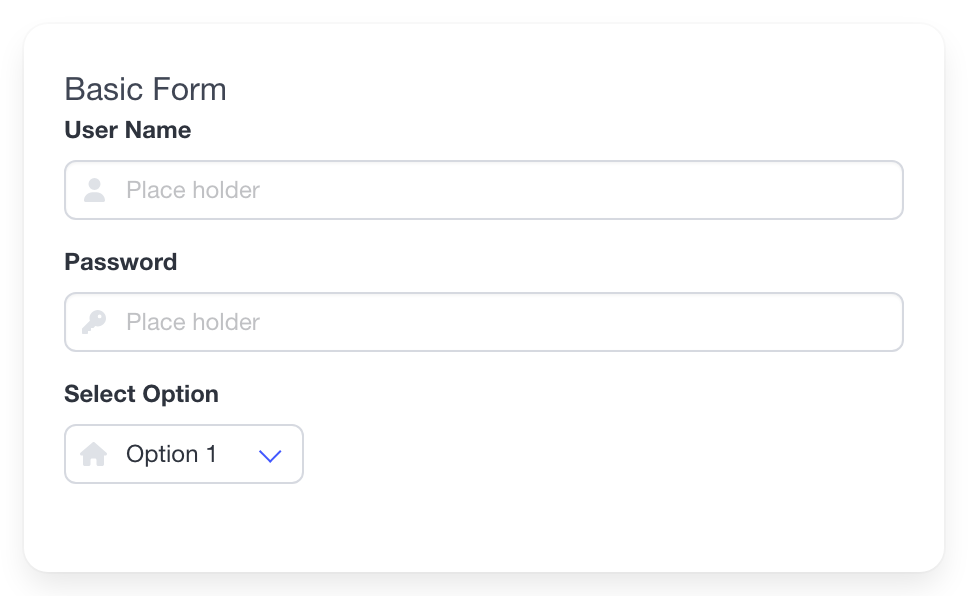

# Mito Forms

**Render React UI from declarative JSON metadata.**

[](https://github.com/vlad-eroshin/mito-forms/actions/workflows/devBuild.yml)
[](https://www.npmjs.com/package/@mito-forms/core)
[](https://www.npmjs.com/package/@mito-forms/bulma)

Mito Forms is a runtime that turns a declaration into a working UI. You describe forms, fieldsets, fields, their
conditions, and their data sources as plain metadata; the runtime resolves each declared type to a component, manages
state, and reports the edited result.

Because the UI is data rather than hand-written JSX, it can be stored, versioned, sent from a server, or generated at
runtime, and the same declaration renders with any component set you register.

## Quick look

<table>
<tr>
<th>Declaration</th>
<th>Rendered UI</th>
</tr>
<tr>
<td>

```ts
import { EditorMetadata } from '@mito-forms/core';

export const basicEditor: EditorMetadata = {
  forms: [
    {
      id: 'form1',
      title: 'Basic Form',
      fieldSets: [
        {
          name: 'fieldset1',
          fields: [
            {
              type: 'text',
              name: 'username',
              label: 'User Name',
              required: true,
              customProps: { leftIcon: 'faUser' },
            },
            {
              type: 'password',
              name: 'password',
              label: 'Password',
              required: true,
              customProps: { leftIcon: 'faKey' },
            },
            {
              type: 'select',
              name: 'selector',
              label: 'Select Option',
              default: 1,
              options: [
                { label: 'Option 1', value: 1 },
                { label: 'Option 2', value: 2 },
              ],
              customProps: { leftIcon: 'faHome' },
            },
          ],
        },
      ],
    },
  ],
  reducersMap: {},
};
```

</td>
<td>



</td>
</tr>
</table>

More declarations and the UI they produce: [live Storybook](https://vlad-eroshin.github.io/mito-forms/storybook/bulma).

## Install

```bash
npm install @mito-forms/core @mito-forms/bulma
```

Pass a declaration and a component registry to `FormEditor`:

```tsx
import { FormEditor } from '@mito-forms/core';
import { BULMA_REGISTRY } from '@mito-forms/bulma';

<FormEditor
  editorMetadata={basicEditor}
  initialData={{}}
  onChange={result => console.log(result)}
  componentRegistry={BULMA_REGISTRY}
/>;
```

## How it works

- **Component registry.** A declared `type` (`text`, `select`, `switchList`, ...) is resolved to an implementation
  through a `ComponentRegistry` ([`types/registry.ts`](libs/core/src/types/registry.ts)). The core ships no visual
  components; swap the registry and the same declaration renders with a different UI kit.
- **Expression layer.** Attributes such as `render` and `value` accept `!{...}` [JMESPath](https://jmespath.org/)
  expressions, evaluated against live form state and context. See [Conditional logic](#conditional-logic).
- **Data binding.** Fields declare `dataBindings` to named data sources, and accessors
  ([`data/accessor`](libs/core/src/data/accessor)) pull values out of them by property or JSON path, so options and
  values can come from an API instead of the declaration.

What follows from that design:

- **Declarative.** Forms, tabs, fieldsets, list editors, and fields are plain data, fixed or generated at runtime.
- **UI-kit agnostic.** Core logic is separate from rendering; adapters such as Bulma are independent packages.
- **Self-contained state.** No Redux, Zustand, or Recoil; state lives in the editor, with reducers you can supply.
- **Extensible.** Register custom field types, validators, and decorators for field, fieldset, and form layout.
- **Typed.** Written in TypeScript; declarations are checked and auto-completed in the editor.
- **Small.** Few runtime dependencies beyond React and JMESPath.

## Conditional logic

Mito Forms uses **JMESPath** expressions to control field visibility and dynamic behavior.

### How it works

- Each field can have an optional `render` or `disabled`.
- The condition must be written inside `!{<path>}` using a **JMESPath** expression.
- At runtime, Mito Forms evaluates the JMESPath expression against the current form state and other contextual objects (
  `_STATE`, `_CONTEXT`, and current fieldset field values).

If the evaluated result is truthy (non-empty array, true value, non-null), the field will be shown or enabled.

### Example

Only show field if `color` selected is `blue`

```json
{
  "name": "favoriteColor",
  ........................
  "render": "!{_STATE.Form1.fieldset2.data.color == `blue`}"
}
```

Disable field if user indicated that he has a car

```json
{
  "name": "makeOfTheCar",
  ........................
  "disable": "!{_STATE.Form1.fieldset2.data.userHasNoCar}"
}
```

### Expression Rules

- Expressions must start and end with `{}`.
- Inside the braces `{}`, you must use **JMESPath** syntax.
- String comparisons must use backticks \` in JMESPath.
- Array filtering and projections are fully supported.

### Resources

- [JMESPath Tutorial](https://jmespath.org/tutorial.html)
- [JMESPath Examples](https://jmespath.org/examples.html)

## Packages

| Package                            | What it is                                                              |
| :--------------------------------- | :---------------------------------------------------------------------- |
| [`@mito-forms/core`](libs/core)    | UI-kit-agnostic runtime: registry, state, expressions, data binding     |
| [`@mito-forms/bulma`](libs/bulma)  | [Bulma](https://bulma.io/) adapter: inputs, layouts, tabs, list editors |

## Development

To build all Mito Forms packages (core and UI libraries):

```bash
pnpm run build
```

This will:

- Build `libs/core`
- Build `libs/bulma`

### Developing locally

You can start a Storybook server for the Bulma package:

```bash
cd libs/bulma
pnpm run storybook
```

Make sure the core package is built first if you modify it.

## Roadmap

- Support for additional UI frameworks (Material UI, Bootstrap, etc.)
- Dynamic field validation rules
- More powerful form layout options

## License

[MIT](LICENSE) © [Vladislav Eroshin](https://github.com/vlad-eroshin)
